# 0. Quy tắc gắn biến cho parameter

- **Phân loại:** `TOPIC`
- **Đường dẫn phân cấp:** `BSV_Arch_Working process / Step 4: Thống kê khối lượng và nhập BoQ / 0. Quy tắc gắn biến cho parameter`

## 📋 Các nội dung / Quy chuẩn kỹ thuật chi tiết

### 0.1 - 0.1. Tường xây

### 0.2 - 0.2. Khối lượng hoàn thiện tường

### 0.7 - 0.7. Sàn hoàn thiện

### 0.7 - 0.7. Trần hoàn thiện

### 0.8 - 0.8. Chống thấm

### 0.9 - 0.9. Cửa đi và Kl Trát cạnh cửa, Sill cửa (tương tự cho cửa sổ)

### 0.10 - 0.10. Bê tông bổ trụ

### 0.10 - 0.10. Bê tông lanh tô giằng tường

### 0.11 - 0.11. Ván khuôn bổ trụ LTGT

### 0.12 - 0.12. Hoàn thiện kết cấu

### 0.13 - 0.13. Hoàn thiện kết cấu Detail

### Q.3 - Q.3. Những đầu mục thường bổ sung

### NOTE: Bảng thống kê Quatities

### NOTE: Bảng thống kê Material

### NOTE: Bảng thống kê Quatities

### NOTE: Bảng thống kê Quatities

### NOTE: Bảng thống kê Multi Material

### NOTE: Bảng thống kê Quantities

### NOTE: Bảng thống kê Quantites

### NOTE: Bảng thống kê Quantities

### NOTE: Bảng thống kê Quantities

### NOTE: Bảng thống kê Quantities

### bảng này tương tự bảng HTKC nhưng bảng này sẽ dùng để quản lí quá trình gán tham biến cho parameter BSV_HTKC

### - Trát cạnh cửa, đỉnh tường

### 0.1.1 - 0.1.1. Comments

### 0.1.1 - 0.1.1. Comments

### 0.1.1 - 0.1.1. Comments

### 0.1.1 - 0.1.1. Comments

### 0.9.1 - 0.9.1. Comments

### 0.1.1 - 0.1.1. Comments

### 0.10.1 - 0.10.1. Comments

### 0.1.1 - 0.1.1. Note

### 0.1.1 - 0.1.1. BSV_HTKC

### - KL giàn giáo xây tô: tính bằng diện tích tường full k bao gồm cửa, khoảng trừ cột, dầm nhân 2 ( áp dụng tường >3.4m)

### 0.1.2 - 0.1.2. Note

### 0.1.2 - 0.1.2. Note

### 0.1.2 - 0.1.2. Note

### 0.1.2 - 0.1.2. Note

### 0.9.3 - 0.9.3. BSV_TratFull

### 0.1.3 - 0.1.3. BSV_PhanKhu

### 0.10.2 - 0.10.2. BSV_PhanKhu

### 0.1.3 - 0.1.3. BSV_PhanKhu

### 0.1.3 - 0.1.3. BSV_PhanKhu

### - Trát kết cấu ( những vị trí kết cấu cần trát mà k có công tác BoQ)

### 0.1.3 - 0.1.3. BSV_PhanKhu

### 0.1.3 - 0.1.3. BSV_PhanKhu

### 0.1.3 - 0.1.3. BSV_PhanKhu

### 0.1.3 - 0.1.3. BSV_PhanKhu

### 0.9.4 - 0.9.4. BSV_Trat1m

### 0.1.4 - 0.1.4. BSV_XuongChinh

### 0.10.3 - 0.10.3. BSV_XuongChinh

### 0.1.4 - 0.1.4. BSV_XuongChinh

### 0.1.4 - 0.1.4. BSV_XuongChinh

### 0.1.4 - 0.1.4. BSV_XuongChinh

### 0.1.4 - 0.1.4. BSV_XuongChinh

### 0.1.4 - 0.1.4. BSV_XuongChinh

### 0.1.4 - 0.1.4. BSV_XuongChinh

### 0.9.5 - 0.9.5. KL_TratCanhCua

### Hình ảnh minh họa

### 0.10.4 - 0.10.4. BSV_HTKC

### Hình ảnh minh họa

### 0.1.4 - 0.1.4. BSV_PhanLoai

### Hình ảnh minh họa

### Hình ảnh minh họa

### Hình ảnh minh họa

### Hình ảnh minh họa

### 0.9.5 - 0.9.5. KL_TratCanhCua1m

### Hình ảnh minh họa

### 0.1.5 - 0.1.5. Các bước thực thi

### 0.9.5 - 0.9.5. BSV_ChieuDayThachCao

### Hình ảnh minh họa

### 0.9.5 - 0.9.5. KL_ThachCaoCua

### 0.9.2 - 0.9.2. BSV_ChieuDayTuong

### 0.9.2 - 0.9.2. KL_SillCuaDi

### 0.9.5 - 0.9.5. BSV_PhanKhu

### 0.9.6 - 0.9.6. BSV_XuongChinh

### Hình ảnh minh họa

### TuongVach

### Note ghi lại mô tả đối tượng được chia trong BoQ (Tùy dự án sẽ có những đối tượng khác nhau) ghi hoa chữ cái đầu tiên: ví dụ VachThachCao, TuongTrong . . .

### Phân khu xưởng hoặc hạng mục khác: "Khu cần phân"

### Đặt tên xưởng để phân xưởng cho file combine: "tên xưởng"

### Minh họa: Hình ảnh minh họa

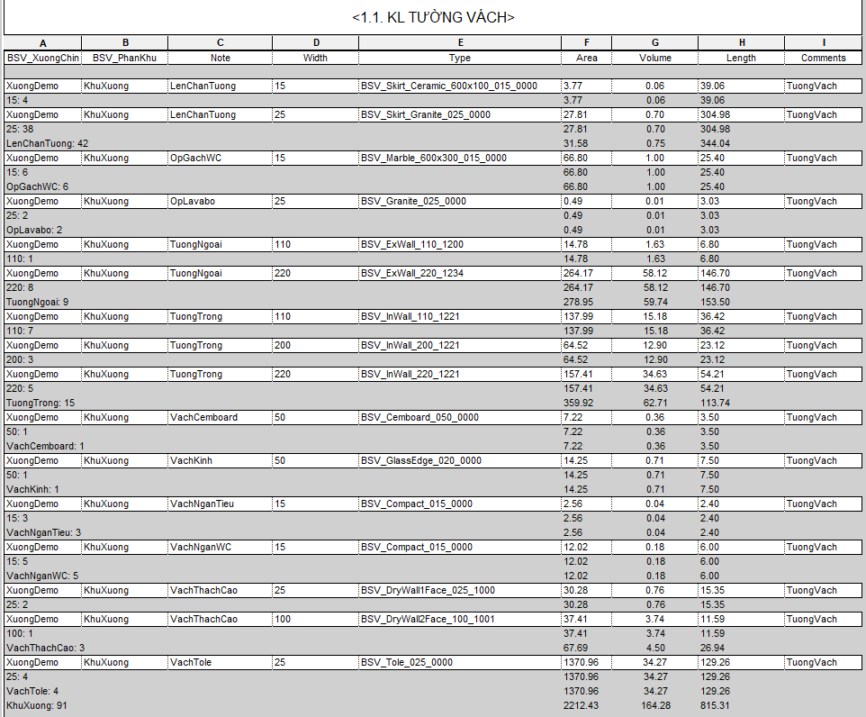
*Minh họa: Hình ảnh minh họa*

### Minh họa: NOTE: Bảng thống kê Material

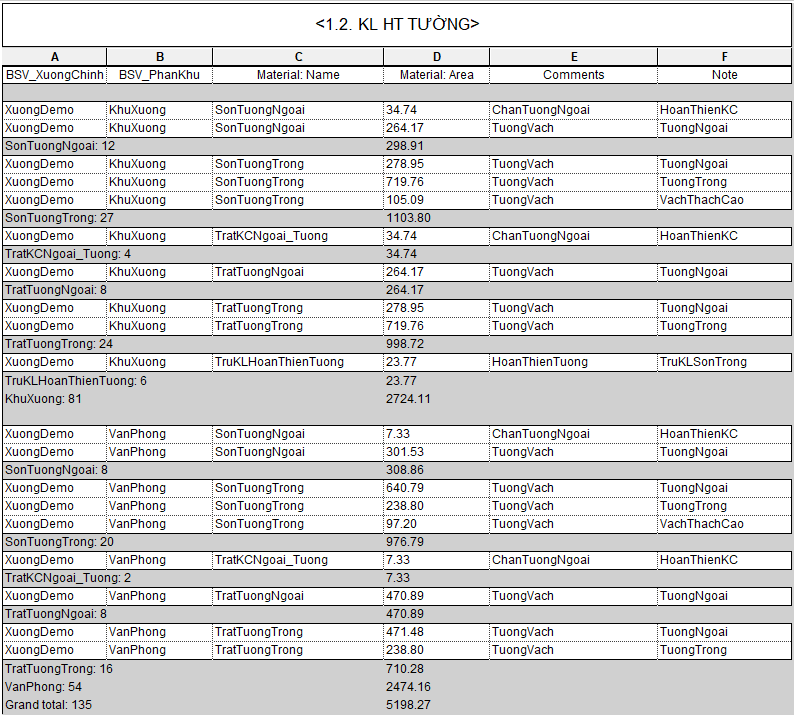
*Minh họa: NOTE: Bảng thống kê Material*

### HoanThienSan

### "Tên loại sàn hoặc phạm vi sàn cần tách theo BoQ"

### Phân khu xưởng hoặc hạng mục khác: "Khu cần phân"

### Đặt tên xưởng để phân xưởng cho file combine: "tên xưởng"

### Minh họa: Hình ảnh minh họa

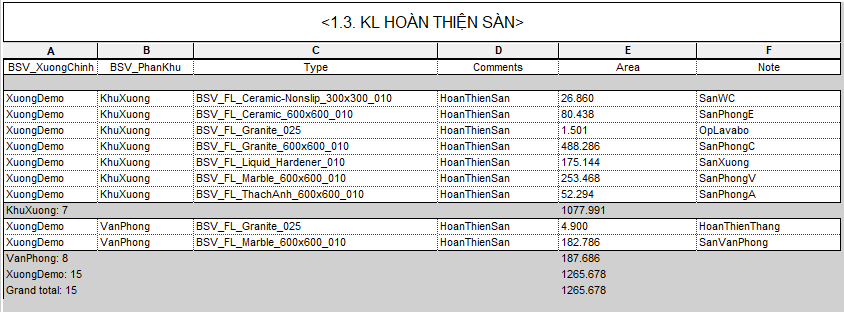
*Minh họa: Hình ảnh minh họa*

### HoanThienTran

### "Tên loại trần hoặc phạm vi trần cần tách theo BoQ"

### Phân khu xưởng hoặc hạng mục khác: "Khu cần phân"

### Đặt tên xưởng để phân xưởng cho file combine: "tên xưởng"

### Minh họa: Hình ảnh minh họa

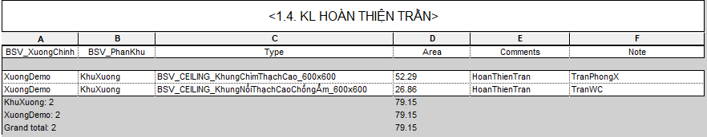
*Minh họa: Hình ảnh minh họa*

### ChongTham

### "Tên loại chống thấm hoặc phạm vi chống thấm cần tách theo BoQ"

### Phân khu xưởng hoặc hạng mục khác: "Khu cần phân"

### Đặt tên xưởng để phân xưởng cho file combine: "tên xưởng"

### Minh họa: Hình ảnh minh họa

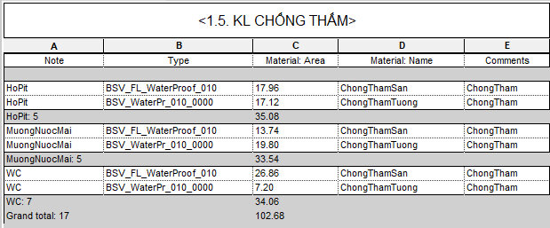
*Minh họa: Hình ảnh minh họa*

### Điền thông tin khối lượng bổ sung sẽ tính theo cửa

### Điền 1 nếu cửa nằm trong tường, các cạnh của cửa đều cần trát        Điền 0 nếu cửa nằm trên tường 1m hoặc có chiều cao cố định

### Điền 0 nếu cửa nằm trong tường, các cạnh của cửa đều cần trát        Điền 1 nếu cửa nằm trên tường 1m hoặc có chiều cao cố định

### KL sử dụng đối với những cửa có giá trị BSV_TratFull là "1"

### KL sử dụng đối với những cửa có giá trị BSV_TratFull là "0"

### KL sử dụng đối với những cửa có giá trị BSV_ChieuDayThachCao

### KL thạch cao ốp cửa sẽ được cộng vào KL Vách thạch cao

### Chạy tool: BSV_Arch_LayChieuDayTuongChoCua_V1

### KL Sill cửa đi

### Phân khu xưởng hoặc hạng mục khác: "Khu cần phân"

### Đặt tên xưởng để phân xưởng cho file combine: "tên xưởng"

### Minh họa: Hình ảnh minh họa

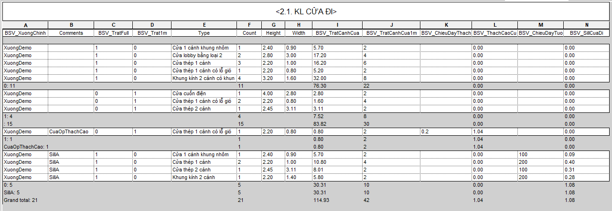
*Minh họa: Hình ảnh minh họa*

### BoTru

### Phân khu xưởng hoặc hạng mục khác: "Khu cần phân"

### Đặt tên xưởng để phân xưởng cho file combine: "tên xưởng"

### Minh họa: Hình ảnh minh họa

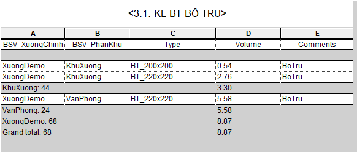
*Minh họa: Hình ảnh minh họa*

### LTGT

### Phân khu xưởng hoặc hạng mục khác: "Khu cần phân"

### Đặt tên xưởng để phân xưởng cho file combine: "tên xưởng"

### "TratDinhTuong" gán cho cấu kiện giằng đỉnh tường có khối lượng trát

### Minh họa: Hình ảnh minh họa

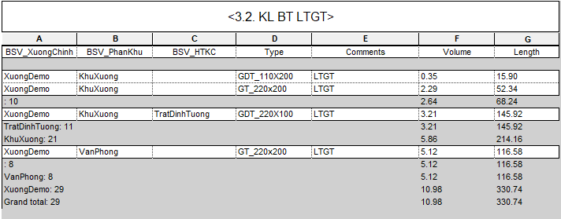
*Minh họa: Hình ảnh minh họa*

### "VK_BoTru đối với bổ trụ, VK_LTGT đối với lanh tô giằng tường"

### Phân khu xưởng hoặc hạng mục khác: "Khu cần phân"

### Đặt tên xưởng để phân xưởng cho file combine: "tên xưởng"

### Minh họa: Hình ảnh minh họa

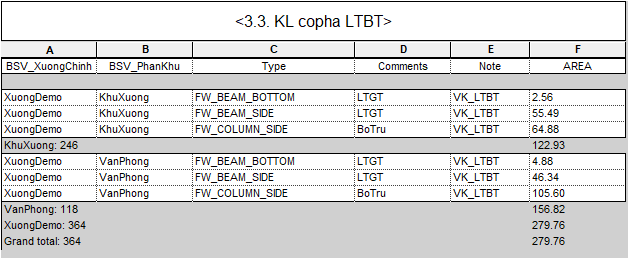
*Minh họa: Hình ảnh minh họa*

### NOTE: Sẽ gán cả trát và sơn vào HTKC kèm theo cấu kiện Host: Ví dụ : TratTrongSonTrong_LTBT

### Phân khu xưởng hoặc hạng mục khác: "Khu cần phân"

### Đặt tên xưởng để phân xưởng cho file combine: "tên xưởng"

### BSV_PhanLoai sẽ dùng để phân loại các loại cấu kiện theo BoQ (tên thang, tên tam cấp...)

### Minh họa: Hình ảnh minh họa

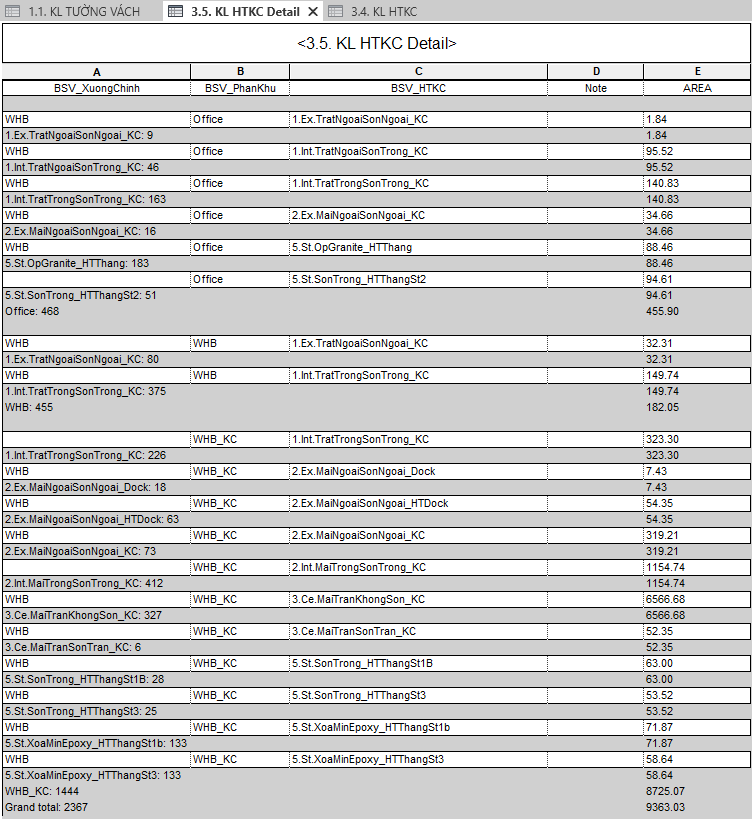
*Minh họa: Hình ảnh minh họa*

### Minh họa: bảng này tương tự bảng HTKC nhưng bảng này sẽ

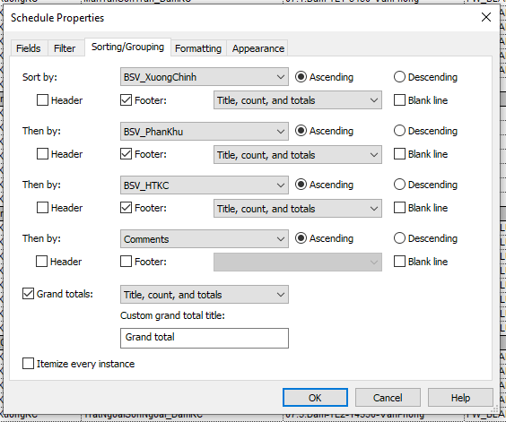
*Minh họa: bảng này tương tự bảng HTKC nhưng bảng này sẽ*

### filter

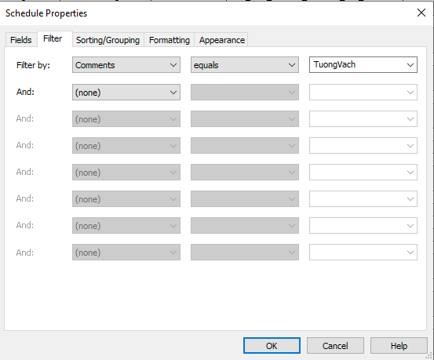
*filter*

### filter

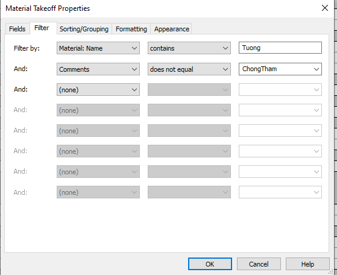
*filter*

### filter

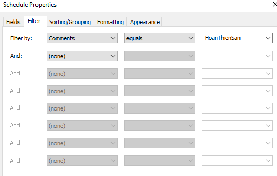
*filter*

### filter

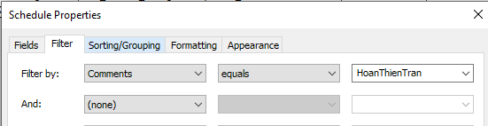
*filter*

### filter

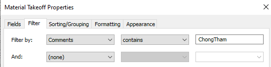
*filter*

### Những cửa nằm hoàn toàn trên kết cấu thép thì điền BSV_TratFull = 0, BSV_Trat1m=0: => những cửa này k lấy KL tô trát

### Những cửa nằm hoàn toàn trên kết cấu thép thì điền BSV_TratFull = 0, BSV_Trat1m=0: => những cửa này k lấy KL tô trát

### sorting

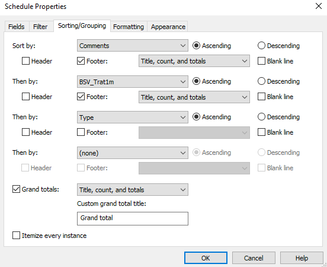
*sorting*

### filter

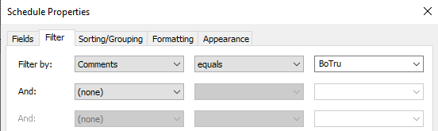
*filter*

### filter

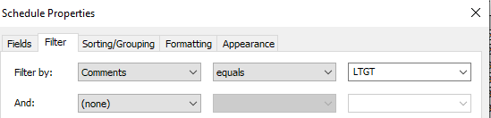
*filter*

### filter

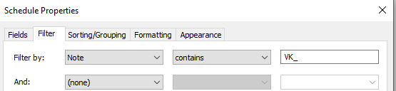
*filter*

### Nguyên tắc gán giá trị cho parameter BSV_HTKC

### filter

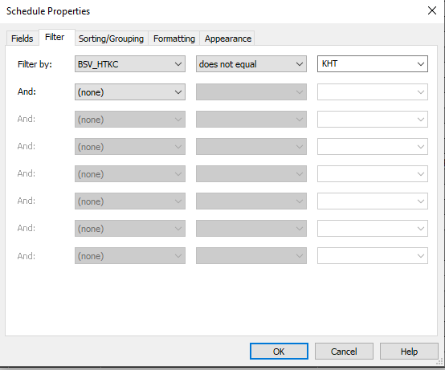
*filter*

### sorting

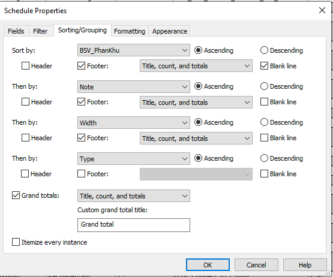
*sorting*

### sorting

*sorting*

### sorting

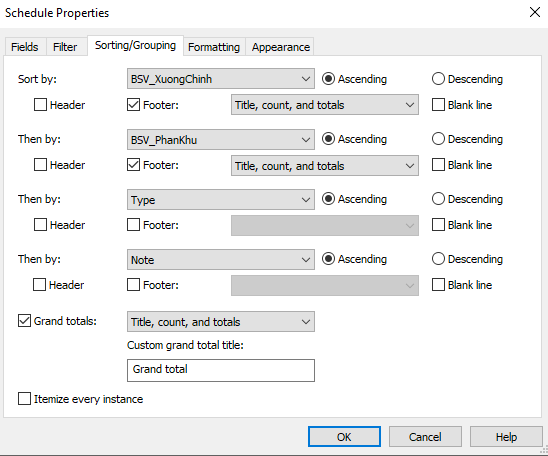
*sorting*

### sorting

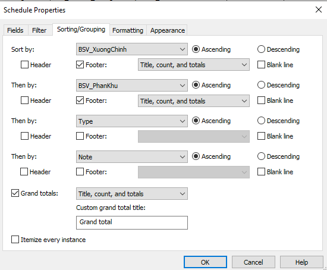
*sorting*

### sorting

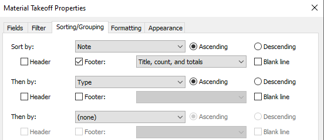
*sorting*

### sorting

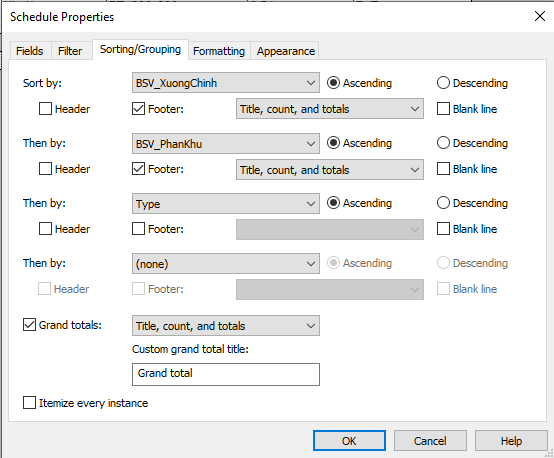
*sorting*

### sorting

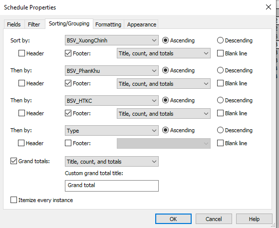
*sorting*

### sorting

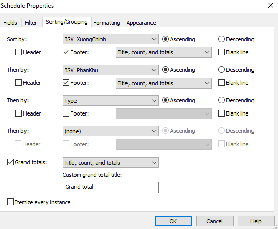
*sorting*

### sorting

*sorting*

### Material Name: TruKLHoanThienTuong

### Sill cửa

### BSV_ChieuDayThachCao: chính là chiều dày tấm thạch cao cho phần ốp cửa (nhập tay)

### Lưu ý mặt tường giao giữa văn phòng và xưởng tính cho tường văn phòng và mặt giao đó tính là TratNgoaiSonTrong_LTBT

### Tên công tác viết liền không dấu và in hoa chữ cái đầu. Những công tác chính

### Lưu ý cách vào KL trong BoQ

### Những mặt ván khuôn k tận dụng làm HTKC sẽ gán biến KHT

### Minh họa: Minh họa: bảng này tương tự bảng HTKC nhưng b

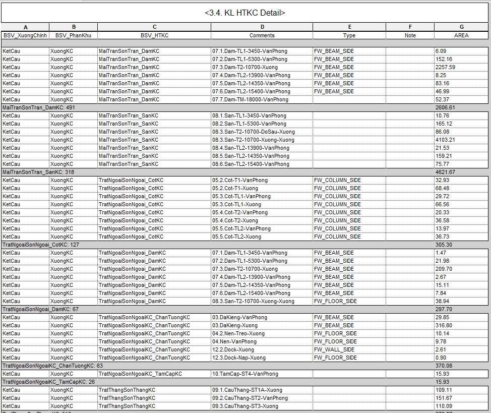
*Minh họa: Minh họa: bảng này tương tự bảng HTKC nhưng b*

### Cửa có ốp thạch cao

### Phần kl dùng để trừ ra những vị trí k hoàn thiện sơn hoặc trát, hoặc cả 2. ghi chú ở Note

### TratNgoai

### Tất cả những đầu mục bắt đầu bằng cos 1 sẽ được cộng vào KL hoàn thiện của tường xây

### TratTrong

### Tất cả những đầu mục bắt đầu bằng cos 2 sẽ được cộng vào KL hoàn thiện kết cấu

### SonNgoai

### Tất cả những đầu mục bắt đầu bằng cos 3 sẽ được cộng vào KL hoàn thiện dầm(trần)

### SonTrong

### Tất cả những đầu mục bắt đầu bằng cos 4 sẽ được cộng vào KL hoàn thiện trần

### MaiNgoai

### Tất cả những đầu mục bắt đầu bằng cos 5 sẽ được cộng vào KL hoàn thiện thang hoặc tam cấp

### MaiTrong

### Tất cả những đầu mục bắt đầu bằng cos 6 sẽ được cộng vào KL hoàn thiện sàn thang bộ, tam cấp

### Nếu BoQ có đầu mục riêng cho các phần kết cấu như cột, vách. . .  thì nhập đúng phạm vi

### Nếu BoQ tách riêng phần hoàn thiện dầm và trần riêng thì cos 3 sẽ được cộng vào hoàn thiện dầm

### Nếu BoQ không tách riêng công tác hoàn thiện thang bộ và tam cấp thì

### Nếu BoQ không có đầu mục công tác riêng thì bổ sung đầu mục mới ở cuối

### Nếu BoQ k tác riêng dầm và trần thì cos 3 sẽ được cộng vào hoàn thiện trần

### KL hoàn thiện thang bộ sẽ cộng vào KL hoàn thiện trần

### KL hoàn thiện tam cấp sẽ cộng vào hoàn thiện kết cấu (trong hoặc ngoài nhà)
