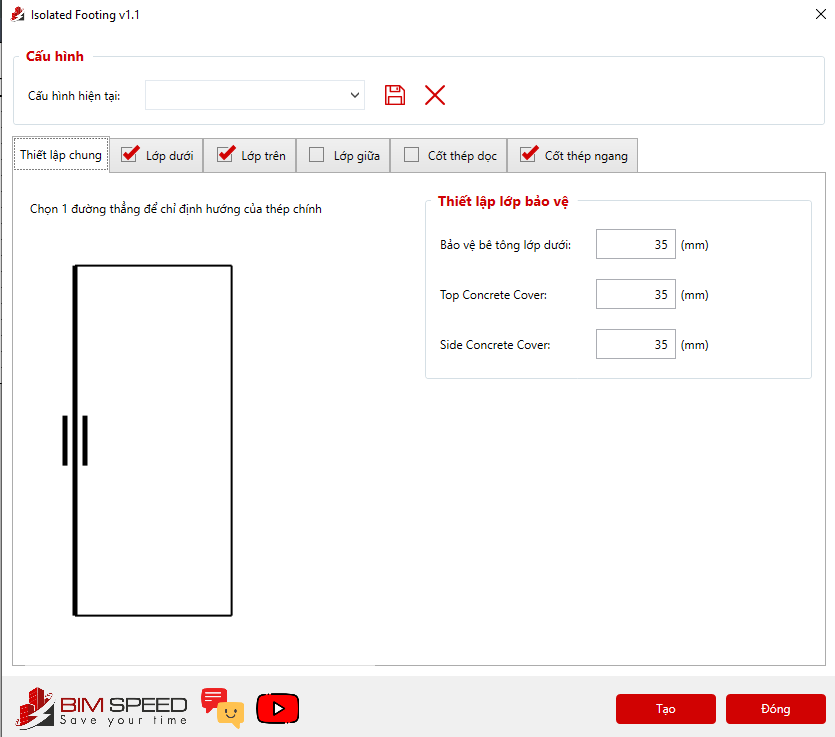

# Quy cách vẽ  - (Chạy tool Bimspeed vẽ móng)

- **Phân loại:** `TOPIC`
- **Đường dẫn phân cấp:** `SHOP DRAWING REBAR / 02.Móng / Quy cách vẽ  (Chạy tool Bimspeed vẽ móng)`

## 📋 Các nội dung / Quy chuẩn kỹ thuật chi tiết

### Móng đơn

### Những loại móng khác

### Nhập lớp btbv

### Vẽ lớp thép trên , lớp thép dưới

### Lớp giữa, Cốt thép dọc , Cốt thép ngang (Nếu có) ,

### Minh họa: Móng đơn

*Minh họa: Móng đơn*
