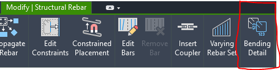

# Xuất bản vẽ

- **Phân loại:** `TOPIC`
- **Đường dẫn phân cấp:** `SHOP DRAWING REBAR / 02.Móng / Xuất bản vẽ`

## 📋 Các nội dung / Quy chuẩn kỹ thuật chi tiết

### Gán view teamplate

### Mặt bằng

### Mặt cắt

### Viewport

### BSV_02.1_Detail_Foudation

### Quy ước thê hiện mặt cắt bản vẽ
> (Mặt cắt thể hiện vị trí nhìn từ trên xuống , Từ trái qua phải)

### Cao độ

### Mặt bằng:
> BSV_Tittle_Plan_Fou

### Dim

### Nét dừng cấu kiện

### Mặt cắt:
> BSV_Title_Sec_Fou

### Tag

### Dim

### Tag

### Section: BSV_02_Sec_Foudation

### BSV_Dim

### Tag Thép 2D bằng công cụ:[Rebar bending detail]

### BSV_CaoDo

### BSV_Bearkline

### BSV_Dim

### Tag Thép 2D bằng công cụ:[Rebar bending detail]

### BSV_ViewNameVN: [MẶT BẰNG]

### BSV_ViewNameVN: [MẶT CẮT]

### Tag Thép trên mặt bằng (tắt leadear) :
> Vd: [BSV_02.0_TagRebar_Fou_SL_D_a]

### Tag Thép trên mặt cắt (thể hiện leadear) :
> BSV_02.1_TagRebar_Fou_SL_D_a

### Tag rebar bending detail (tắt leader)
> Vd: [BSV_02.1_TagRebar_Fou_SL_D_a]

### Tag Thép trên mặt cắt (thể hiện leadear) :
> Mutil-Rebar Annotations:
> Vd: BSV_02.2_TagRebar_Fou_Opendot_Sl_D_a

### Minh họa: Tag

*Minh họa: Tag*
