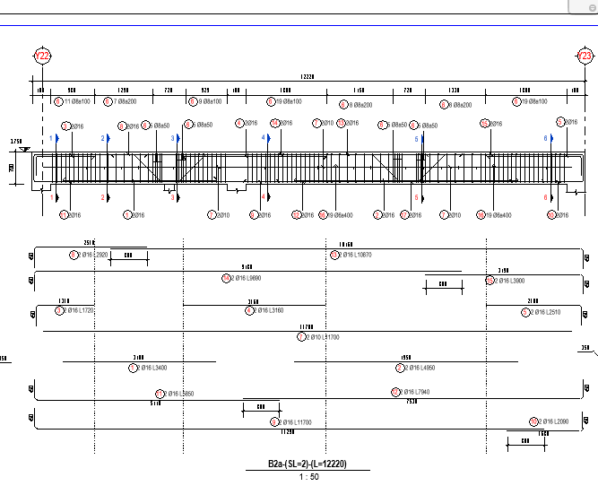

# Vẽ đường giống thể hiện phạm vi nối cắt thép

- **Phân loại:** `TOPIC`
- **Đường dẫn phân cấp:** `SHOP DRAWING REBAR / 03.Đà Kiềng / Vẽ đường giống thể hiện phạm vi nối cắt thép`

## 📋 Các nội dung / Quy chuẩn kỹ thuật chi tiết

### Vẽ bằng nét hidden line

### Theo Spec để vẽ đường giống:
> Vd: L/4 hoặc L/6

### Spec không thê hiện thì vẽ :
> L/4 nối thép trên ở bụng
> L/6 nối thép dưới ở gối

### Minh họa: Vẽ đường giống thể hiện phạm vi nối cắt thép

*Minh họa: Vẽ đường giống thể hiện phạm vi nối cắt thép*
