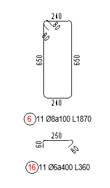
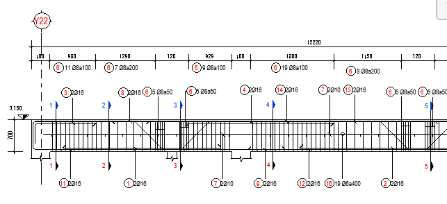
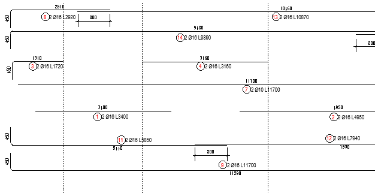
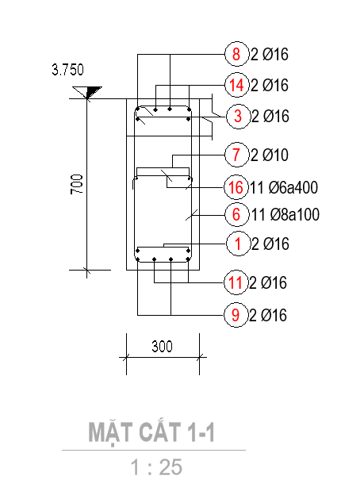

# Xuất bản vẽ

- **Phân loại:** `TOPIC`
- **Đường dẫn phân cấp:** `SHOP DRAWING REBAR / 03.Đà Kiềng / Xuất bản vẽ`

## 📋 Các nội dung / Quy chuẩn kỹ thuật chi tiết

### Gán view teamplate

### Mặt cắt

### Áp dụng cho mặt bằng key plan
> [BSV_03.1_KP_GroundBeam]

### Mặt cắt dọc

### Áp dụng cho mặt cắt dọc
> [BSV_03.2_Detail_GroundBeam]

### Mặt cắt ngang

### Áp dụng cho mặt cắt ngang
> [BSV_03.3_Sectionl_GroundBeam]

### Neo, lap, cắt, khoảng cách giữa 2 lớp thép chủ và tăng cường

### CaoDo

### Quy ước thể hiện mặt cắt bản vẽ
> (Mặt cắt thể hiện vị trí nhìn từ trái qua phải)

### Nét dừng cấu kiện

### CaoDo

### Dim

### Nét dừng cấu kiện

### Tag

### Nét cắt thép

### Kéo thép đai 2D bending detail

### Dim

### Viewport

### Tag

### Kéo thép chủ, thép tăng cường, thép vai bò thép giá, 2D bending detail

### Viewport

### Thép chủ theo Spec:
> Vd: Neo 40d,Lap 40d so le, 
> Thép tăng cường theo Spec:
> Vd: Neo 40d, L/4,

### BSV_CaoDo

### BSV_Bearkline

### BSV_DauThep_Dam

### BSV_Dim

### Tag Thép chủ,tăng cường, thép giá, thép vai bò (thể hiện leadear) :
> Vd: [BSV_03.1_Tag Rebar_Beam_SL_D]

### Theo thứ tự từ trên xuống

### BSV_Title_Large_Sec_Beam

### BSV_CaoDo

### BSV_Bearkline

### BSV_Dim

### Subtopic 3

### Thép đai, thép C bending detail:
> BSV_03.6_Tag Rebar_Beam_Sl_D_a_L

### BSV_Title_Medium_Sec_Beam

### Khoảng cách rải thép đai thép C

### Tag Thép đai, thép giá (thể hiện leadear) :
> BSV_03.3_Tag Reabar Shear_Sl_D_a

### Thép chủ bending detail:
> BSV_03.4_Tag Rebar_Beam_Sl_D_L

### Tag Thép chủ,tăng cường, thép giá (thể hiện leadear) :
> BSV_03.4_Tag Rebar_Beam_Sl_D

### Minh họa: Kéo thép đai 2D bending detail

*Minh họa: Kéo thép đai 2D bending detail*

### Tag Thép C (thể hiện leadear) :
> BSV_03.2_Tag Rebar_Beam_Open dot_SL_D_a

### Dim khoảng cách nối thép

### Tag thép đai, thép C
> BSV_03.5_Tag Rebar_Beam_SL_D_a

### Minh họa: Tag

*Minh họa: Tag*

### Minh họa: Kéo thép chủ, thép tăng cường, thép vai bò th

*Minh họa: Kéo thép chủ, thép tăng cường, thép vai bò th*

### Minh họa: Tag

*Minh họa: Tag*

### BSV_ViewNameVN: [ B2a_(SL=2)_(L=12220) ]

### BSV_ViewNameVN: [MẶT CẮT 1-1 ]
