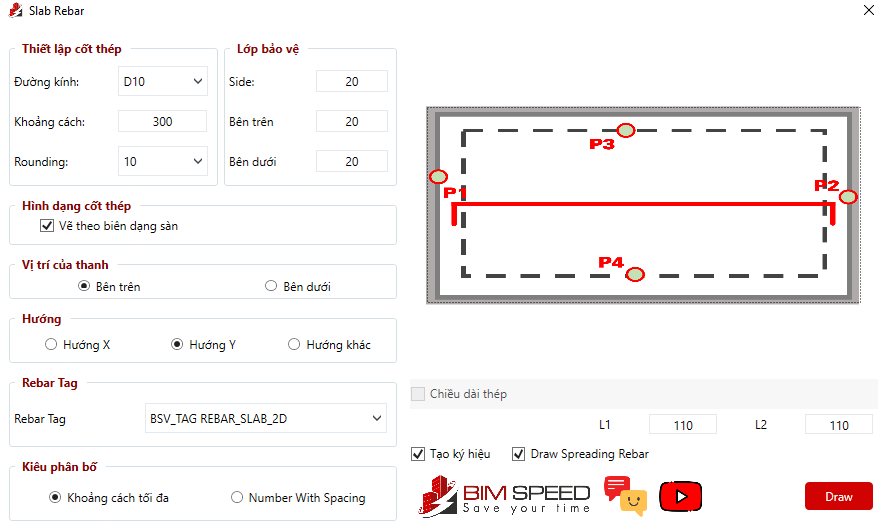

# Quy cách vẽ  - (Chạy tool Bimspeed vẽ sàn)

- **Phân loại:** `TOPIC`
- **Đường dẫn phân cấp:** `SHOP DRAWING REBAR / 04.Nền / Quy cách vẽ  (Chạy tool Bimspeed vẽ sàn)`

## 📋 Các nội dung / Quy chuẩn kỹ thuật chi tiết

### Theo mặt cắt chi tiết .Nếu mặt cắt không thể hiện
> Theo Spec

### Nhập/Kiểm tra lớp btbv

### Thép lớp trên + tăng cường trên

### Thép lớp dưới + tăng cường dưới

### L1=Chiều dày sàn - 2 lớp btbv
> L2=Chiều dày sàn - 2 lớp btbv

### Chọn những biên dạng khác nhấn vào hình ảnh

### Minh họa: Theo mặt cắt chi tiết .Nếu mặt cắt không thể 

*Minh họa: Theo mặt cắt chi tiết .Nếu mặt cắt không thể *
