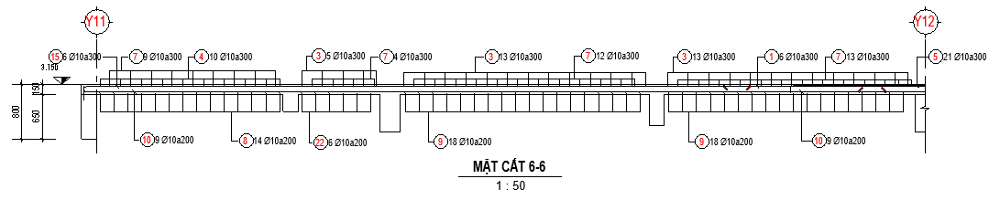
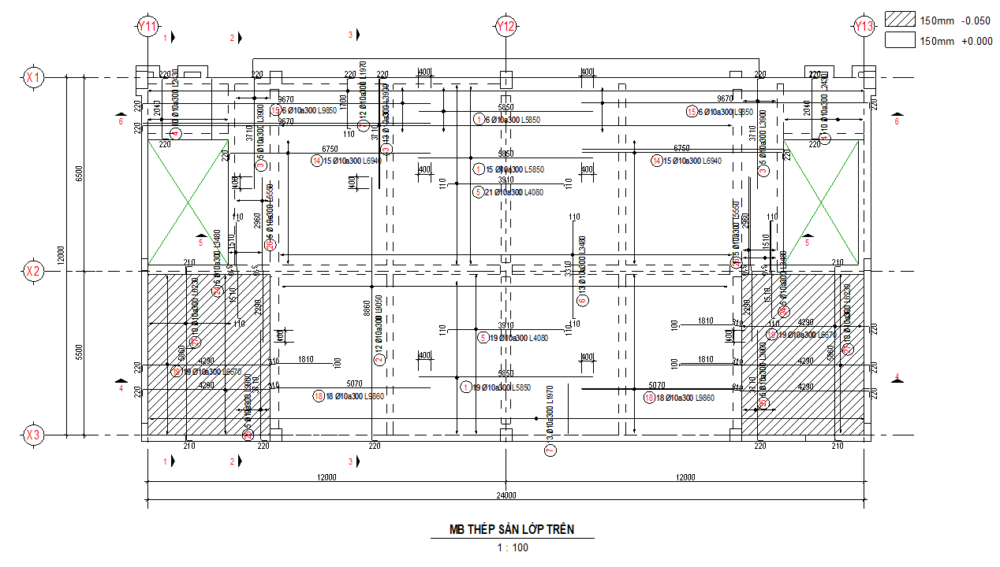
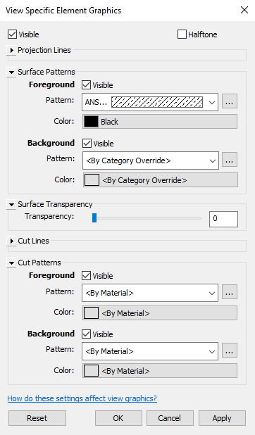

# Xuất bản vẽ

- **Phân loại:** `TOPIC`
- **Đường dẫn phân cấp:** `SHOP DRAWING REBAR / 04.Nền / Xuất bản vẽ`

## 📋 Các nội dung / Quy chuẩn kỹ thuật chi tiết

### Gán view teamplate

### Mặt bằng & Mặt cắt

### Áp dụng với mặt bằng key plan:
> BSV_04.1_KP_Slab

### Mặt bằng

### Áp dụng với mặt bằng thép lớp trên:
> BSV_04.2_PlanSlabTop

### Mặt cắt

### Áp dụng với mặt bằng thép lớp dưới:
> BSV_04.3_PlanSlabBot

### Áp dụng với mặt cắt thép sàn:
> BSV_04.4__Sec_Slab

### Mặt bằng thép lớp trên

### Mặt cắt ngang

### Mặt bằng thép lớp dưới

### Minh họa: Mặt cắt

*Minh họa: Mặt cắt*

### Minh họa: Mặt bằng

*Minh họa: Mặt bằng*

### Neo, lap, cắt,  thép chủ và tăng cường

### CaoDo

### Quy ước thê hiện mặt cắt bản vẽ
> (Mặt cắt thể hiện vị trí nhìn từ trái qua phải)

### Nét dừng cấu kiện

### Cao độ

### Dim

### Nét dừng cấu kiện

### Tag

### Nét cắt thép

### Viewport

### Dim

### Tag

### Kéo thép chủ, thép tăng cường, 2D bending detail

### Thể hiện khoảng rải

### Hatch cao độ

### Viewport

### Thép chủ theo Spec:
> Vd: Neo 40d,Lap 40d so le, 
> Thép tăng cường theo Spec:
> Vd: Neo 40d, L/4,

### BSV_CaoDo

### BSV_Bearkline

### BSV_DauThep_Dam

### BSV_Dim

### Tag Thép chủ,tăng cường,  (tắt leadear) :
> Vd: [BSV_04.1_Tag Rebar_Slab_SL_D_a_L]

### Theo thứ tự từ trên xuống

### Dùng Detail Annnotation
> [BSV_Symbol_RaiThep]

### Override graphic in view> by element

### BSV_04.1_Title_Large_Plan_Slab

### BSV_CaoDo

### BSV_Bearkline

### BSV_Dim

### Thép Lớp trên

### BSV_04.2_Title_Medium_Sec_Slab

### Thép chủ bending detail:
> [BSV_04.1_Tag Rebar_Slab_SL_D_a_L]

### Thép Lớp dưới

### Dim khoảng cách nối thép

### Áp dụng với thép song song (thể hiện leadear) :
> [BSV_04.2_Tag Rebar_Slab_SL_D_a]
> Áp dụng với thép vuông góc ( thể hiện leader):
> [BSV_04.3_Tag Rebar_Slab_OpenDot_Sl_D_a]

### Minh họa: Override graphic in view> by element

*Minh họa: Override graphic in view> by element*

### BSV_ViewNameVN: [ MB THÉP LỚP TRÊN ]

### Phương X

### Phương X

### BSV_ViewNameVN: [MẶT CẮT 6-6 ]

### Phương Y

### Phương Y

### Áp dụng với thép song song (thể hiện leadear) :
> [BSV_04.2_Tag Rebar_Slab_SL_D_a]
> Áp dụng với thép vuông góc ( thể hiện leader):
> [BSV_04.3_Tag Rebar_Slab_OpenDot_Sl_D_a]
