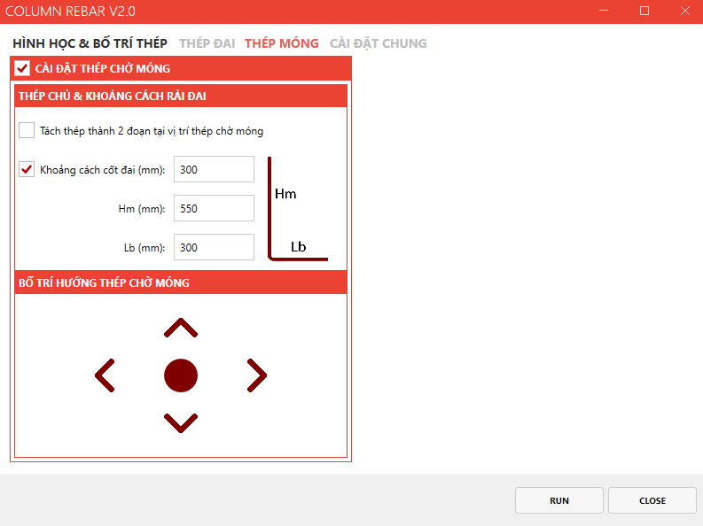

# Quy cách vẽ  - (Chạy tool kaka vẽ Cột)

- **Phân loại:** `TOPIC`
- **Đường dẫn phân cấp:** `SHOP DRAWING REBAR / 05.Cột / Quy cách vẽ  (Chạy tool kaka vẽ Cột)`

## 📋 Các nội dung / Quy chuẩn kỹ thuật chi tiết

### Theo mặt cắt chi tiết .Nếu mặt cắt không thể hiện
> Theo Spec

### Hiệu chỉnh cốt thép theo phương cạnh x,y
> Tiết diện & loại đai
> Thông tin cột
> Nhập/Kiểm tra lớp btbv

### Thép đai:
> Đoạn rải cốt thép
> Quy tắc rải cốt đai chính
> Quy tắc rải cốt đai bổ sung

### Thép chờ móng

### Cài đặt chung:
> Đoạn be móc cốt thép
> Cài đặt cốt thép trên đỉnh 
> Gán thông tin cho thép
> Chiều dài neo và nối thép cột
> Điều kiện uốn hoặc cắt thép
> Vị trí nối cốt thép
> Tùy chọn ở vị trí dầm sàn

### Minh họa: Hiệu chỉnh cốt thép theo phương cạnh x,y
> Tiết

*Minh họa: Hiệu chỉnh cốt thép theo phương cạnh x,y
Tiết*

### Minh họa: Thép đai:
> Đoạn rải cốt thép
> Quy tắc rải cốt đ

*Minh họa: Thép đai:
Đoạn rải cốt thép
Quy tắc rải cốt đ*

### Minh họa: Thép chờ móng

*Minh họa: Thép chờ móng*

### Minh họa: Cài đặt chung:
> Đoạn be móc cốt thép
> Cài đặt c

*Minh họa: Cài đặt chung:
Đoạn be móc cốt thép
Cài đặt c*
