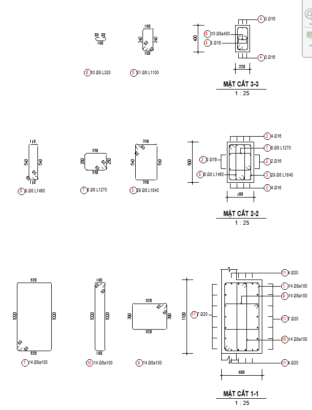
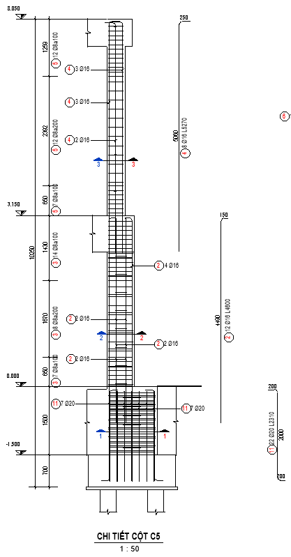

# Xuất bản vẽ

- **Phân loại:** `TOPIC`
- **Đường dẫn phân cấp:** `SHOP DRAWING REBAR / 05.Cột / Xuất bản vẽ`

## 📋 Các nội dung / Quy chuẩn kỹ thuật chi tiết

### Gán view teamplate

### Mặt cắt

### Áp dụng cho mặt bằng key plan
> [BSV_05.1_KP_Column]

### Mặt cắt dọc

### Áp dụng cho mặt cắt dọc
> [BSV_05.2_Detail_Column]

### Mặt cắt ngang

### Neo, lap, cắt, khoảng cách giữa thanh thép

### CaoDo

### Quy ước thê hiện mặt cắt bản vẽ
> (Mặt cắt thể hiện vị trí nhìn từ trái qua phải)

### Nét dừng cấu kiện

### CaoDo

### Dim

### Nét dừng cấu kiện

### Tag

### Nét cắt thép

### Kéo thép đai 2D bending detail

### Dim

### Viewport

### Tag

### Minh họa: Mặt cắt ngang

*Minh họa: Mặt cắt ngang*

### Kéo thép chủ 2D bending detail

### Viewport

### Minh họa: Mặt cắt dọc

*Minh họa: Mặt cắt dọc*

### Thép chủ theo Spec:
> Vd: Neo 40d,Lap 40d so le,

### BSV_CaoDo

### BSV_Bearkline

### BSV_DauThep_Cot

### BSV_Dim

### Tag Thép chủ (thể hiện leadear) :
> BSV_05.1_Tag Rebar _Column_Sl_D

### Theo thứ tự từ trái sang phải

### BSV_Title_Large_Sec_Column

### BSV_CaoDo

### BSV_Bearkline

### BSV_Dim

### Tag Thép chủ (thể hiện leadear) :
> BSV_05.4_Tag Rebar_Column_Sl_D

### Tag thép đai, thép C, thép lồng kín
> BSV_05.2_TagRebarShear_Column_SL_D_a

### BSV_Title_Medium_Sec_Column

### Khoảng cách rải thép đai, thép C, thép lồng kín

### Tag Thép đai, thép giá (tắt leadear) :
> BSV_05.2_TagRebarShear_Column_SL_D_a

### Thép chủ bending detail:
> BSV_05.3_TagRebar_Column_SL_2D

### Thép đai, thép C bending detail:
> BSV_05.4_TagRebar_Column_SL_D_a_L

### Dim khoảng cách nối thép

### BSV_ViewNameVN: [ CHI TIẾT CỘT C5 ]

### BSV_ViewNameVN: [MẶT CẮT 1-1 ]
