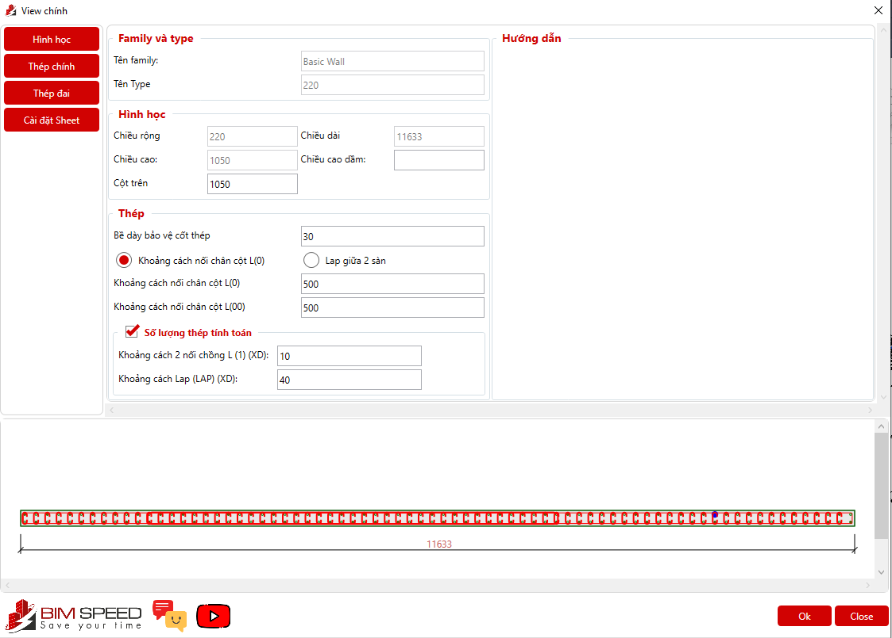
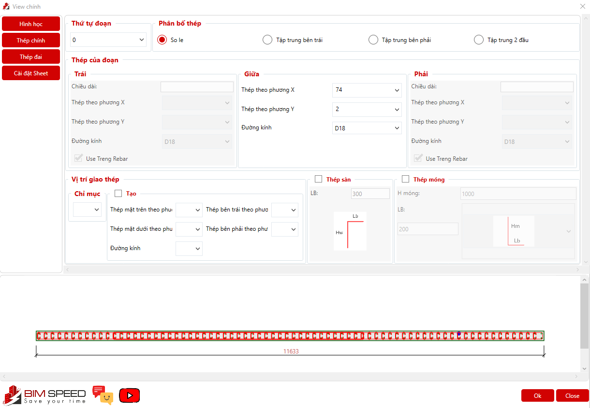
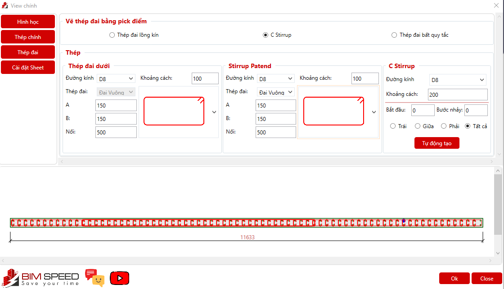
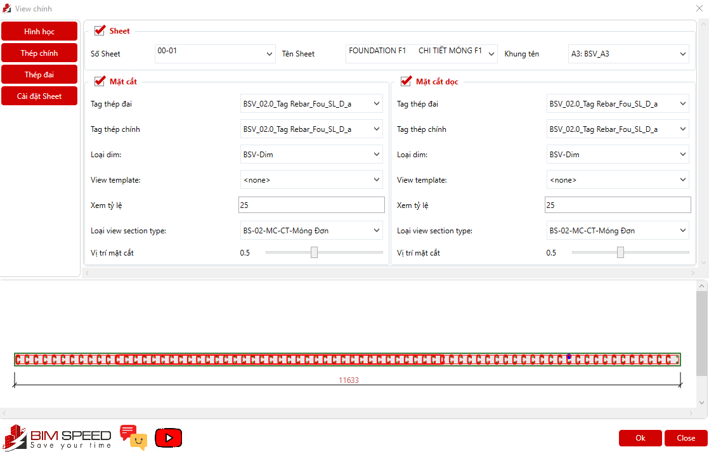

# Quy cách vẽ  - (Chạy tool kaka vẽ vách)

- **Phân loại:** `TOPIC`
- **Đường dẫn phân cấp:** `SHOP DRAWING REBAR / 06.Vách / Quy cách vẽ  (Chạy tool kaka vẽ vách)`

## 📋 Các nội dung / Quy chuẩn kỹ thuật chi tiết

### Theo mặt cắt chi tiết .Nếu mặt cắt không thể hiện
> Theo Spec

### Nhập/Kiểm tra lớp btbv

### Thép lớp dưới + tăng cường dưới

### Thép lớp trên + tăng cường trên

### Thép giá + Thép đai

### Minh họa: Theo mặt cắt chi tiết .Nếu mặt cắt không thể 

*Minh họa: Theo mặt cắt chi tiết .Nếu mặt cắt không thể *

### Minh họa: Minh họa: Theo mặt cắt chi tiết .Nếu mặt cắt 

*Minh họa: Minh họa: Theo mặt cắt chi tiết .Nếu mặt cắt *

### Minh họa: Minh họa: Minh họa: Theo mặt cắt chi tiết .Nế

*Minh họa: Minh họa: Minh họa: Theo mặt cắt chi tiết .Nế*

### Minh họa: Minh họa: Minh họa: Minh họa: Theo mặt cắt ch

*Minh họa: Minh họa: Minh họa: Minh họa: Theo mặt cắt ch*
