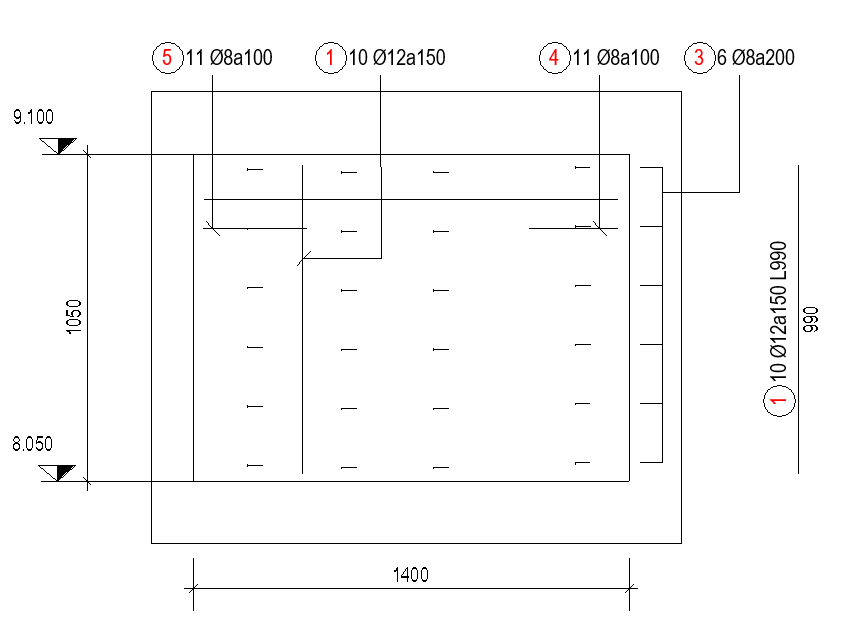
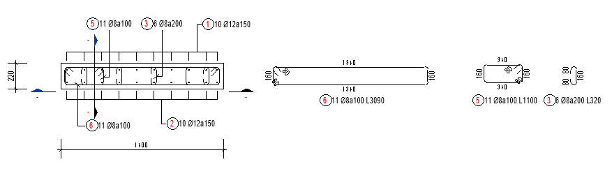

# Xuất bản vẽ

- **Phân loại:** `TOPIC`
- **Đường dẫn phân cấp:** `SHOP DRAWING REBAR / 06.Vách / Xuất bản vẽ`

## 📋 Các nội dung / Quy chuẩn kỹ thuật chi tiết

### Gán view teamplate

### Mặt cắt

### Áp dụng cho mặt bằng key plan
> BSV_06.1_KP_StrWall

### Mặt cắt dọc

### Áp dụng cho mặt cắt dọc
> BSV_06.2_Detail_StrWall

### Mặt cắt ngang

### Áp dụng cho mặt cắt ngang
> BSV_06.3_Sectionl_StrWall

### Neo, lap, cắt, khoảng cách giữa 2 lớp thép chủ và tăng cường

### CaoDo

### Quy ước thể hiện mặt cắt bản vẽ
> (Mặt cắt thể hiện vị trí nhìn từ trái qua phải)

### Nét dừng cấu kiện

### CaoDo

### Dim

### Nét dừng cấu kiện

### Tag

### Nét cắt thép

### Viewport

### Dim

### Minh họa: Mặt cắt ngang

*Minh họa: Mặt cắt ngang*

### Tag

### Kéo thép chủ, thép tăng cường, thép vai bò thép giá, 2D bending detail

### Viewport

### Minh họa: Mặt cắt dọc

*Minh họa: Mặt cắt dọc*

### Thép chủ theo Spec:
> Vd: Neo 40d,Lap 40d so le, 
> Thép tăng cường theo Spec:
> Vd: Neo 40d, L/4,

### BSV_CaoDo

### BSV_Bearkline

### BSV_DauThep_Dam

### BSV_Dim

### Tag Thép chủ,tăng cường, thép giá, thép vai bò (thể hiện leadear) :
> BSV_06.1_Tag Rebar_StrWall_SL_D

### Theo thứ tự từ trên xuống

### BSV_Title_Large_Sec_StrWall

### BSV_CaoDo

### BSV_Bearkline

### BSV_Dim

### Tag Thép chủ,tăng cường, thép giá (thể hiện leadear) :
> BSV_06.1_Tag Rebar_StrWall_SL_D

### BSV_Title_Medium_Sec_StrWall

### Khoảng cách rải thép đai thép C

### Tag Thép đai, thép giá, thép C (thể hiện leadear) :
> BSV_06.3_Tag Reabar Shear_StrWall_Sl_D_a

### Thép chủ bending detail:
> BSV_06.2_Tag Rebar_StrWall_Sl_D_L

### Tag thép đai, thép C, thép lồng kín:
> BSV_06.3_Tag Reabar Shear_StrWall_Sl_D_a

### Dim khoảng cách nối thép(Nếu có)

### BSV_ViewNameVN: [ B2a_(SL=2)_(L=1400) ]

### BSV_ViewNameVN: [MẶT CẮT 1-1 ]
