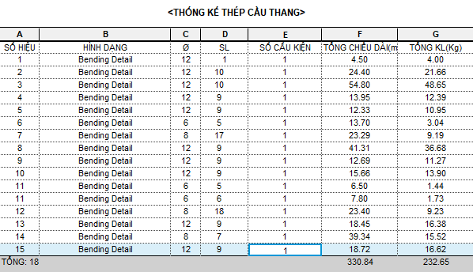

# Bảng thống kê

- **Phân loại:** `TOPIC`
- **Đường dẫn phân cấp:** `SHOP DRAWING REBAR / 09.Cầu Thang / Bảng thống kê`

## 📋 Các nội dung / Quy chuẩn kỹ thuật chi tiết

### THỐNG KÊ THÉP CẦU THANG

### Partitions

### Bending detail

### Bar Diameter

### Quantities

### BSV_SoCauKien

### TỔNG CHIỀU DÀI(mm)

### TỔNG KHỐI LƯỢNG(Kg)

### Minh họa: THỐNG KÊ THÉP CẦU THANG

*Minh họa: THỐNG KÊ THÉP CẦU THANG*

### SỐ HIỆU

### HÌNH DẠNG

### Ø

### SL

### TỔNG CHIỀU DÀI

### TỔNG KHỐI LƯỢNG
