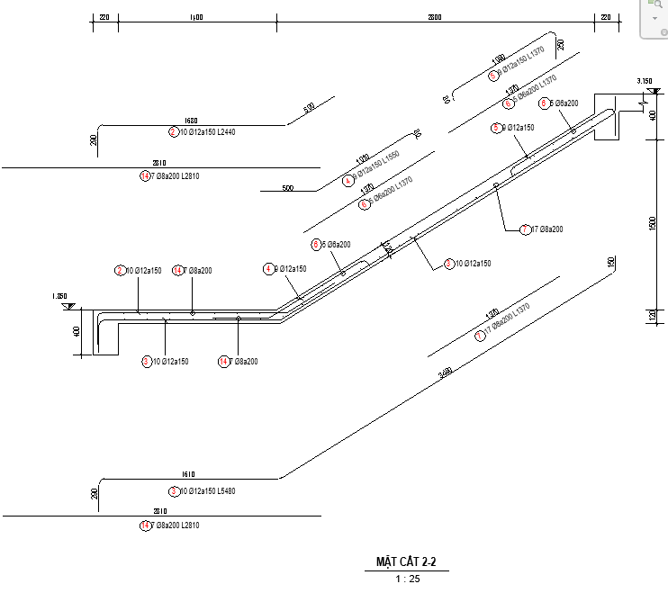
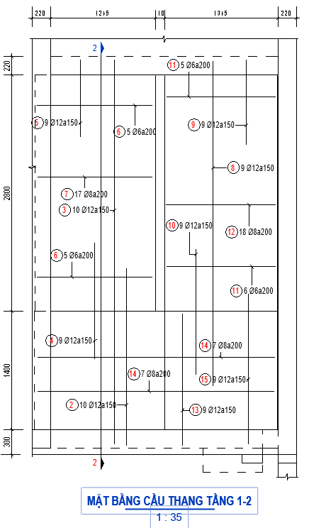

# Xuất bản vẽ

- **Phân loại:** `TOPIC`
- **Đường dẫn phân cấp:** `SHOP DRAWING REBAR / 09.Cầu Thang / Xuất bản vẽ`

## 📋 Các nội dung / Quy chuẩn kỹ thuật chi tiết

### Gán view teamplate

### Mặt bằng & Mặt cắt

### Áp dụng với mặt bằng key plan:
> BSV_09.1_KP_Stair

### Mặt bằng

### Áp dụng với mặt bằng và mặt cắt :
> BSV_09.1_Detail_Stair

### Mặt cắt

### Mặt bằng thép lớp trên

### Mặt cắt ngang

### Mặt bằng thép lớp dưới

### Minh họa: Mặt cắt

*Minh họa: Mặt cắt*

### Minh họa: Mặt bằng

*Minh họa: Mặt bằng*

### Neo, lap, cắt,  thép chủ và tăng cường

### CaoDo

### Quy ước thê hiện mặt cắt bản vẽ
> (Mặt cắt thể hiện vị trí nhìn từ trái qua phải)

### Nét dừng cấu kiện

### Cao độ

### Dim

### Nét dừng cấu kiện

### Tag

### Dim

### Kéo thép chủ 2D bending detail

### Tag thép chủ, thép tăng cường,

### Viewport

### Viewport

### Thép chủ theo Spec:
> Vd: Neo 40d,Lap 40d so le, 
> Thép tăng cường theo Spec:
> Vd: Neo 40d, L/4,

### BSV_CaoDo

### BSV_Bearkline

### BSV_Dim

### Theo thứ tự từ trái sang phải

### BSV_09.1_Title_Large_Plan_Stair

### BSV_CaoDo

### BSV_Bearkline

### BSV_Dim

### Thép Lớp trên

### Theo thứ tự từ trên xuống

### BSV_09.2_Title_Medium_Sec_Stair

### Tag Thép chủ:
> [BSV_09.1_Tag Rebar_Stair_SL_D_a]

### Thép Lớp dưới

### Thép chủ, thép tăng cường bending detail:
> [BSV_09.4_TagRebar_Stair_ SL_D_a_L]

### Dim khoảng cách nối thép

### Áp dụng với thép song song (thể hiện leadear) :
> [BSV_09.2_Tag Rebar_Stair_SL_D_a]
> Áp dụng với thép vuông góc ( thể hiện leader):
> [BSV_09.3_TagRebar_Stair_OpenDot_SL_D_a]

### Dim khoảng cách nối thép (nếu có)

### BSV_ViewNameVN: [ MẶT BẰNG CẦU THANG TÂNG 1-2 ]

### Phương X

### Phương X

### BSV_ViewNameVN: [MẶT CẮT 2-2 ]

### Phương Y

### Phương Y

### Áp dụng với thép song song (thể hiện leadear) :
> [BSV_09.2_Tag Rebar_Stair_SL_D_a]
> Áp dụng với thép vuông góc ( thể hiện leader):
> [BSV_09.3_TagRebar_Stair_OpenDot_SL_D_a]
